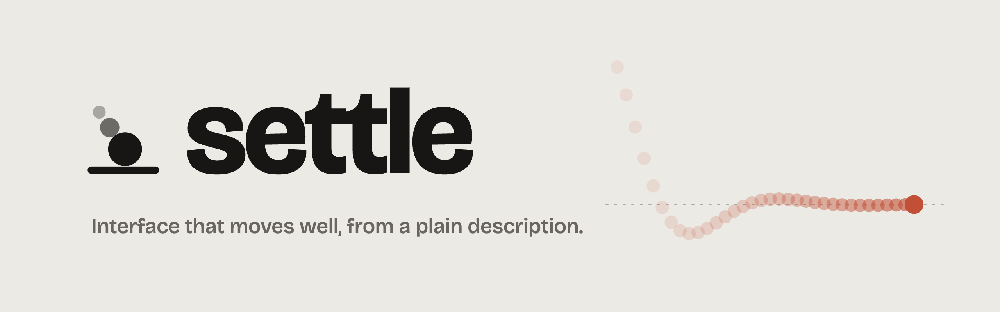
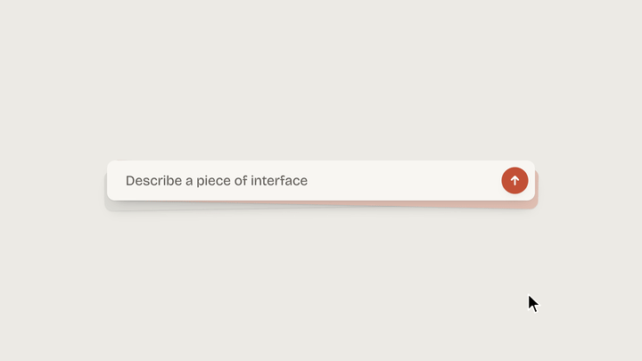
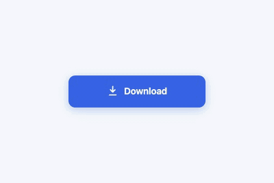
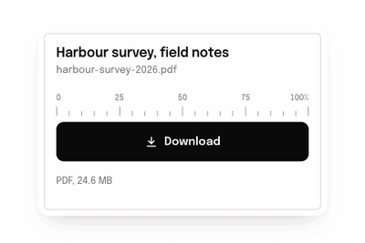
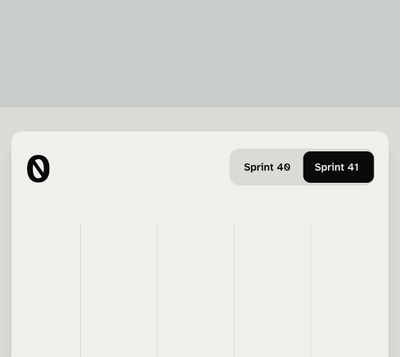
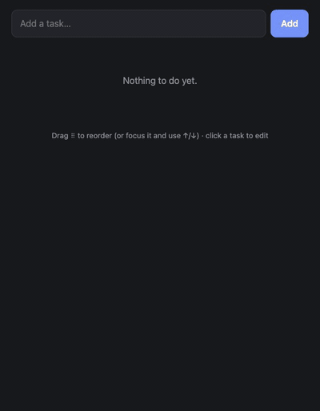
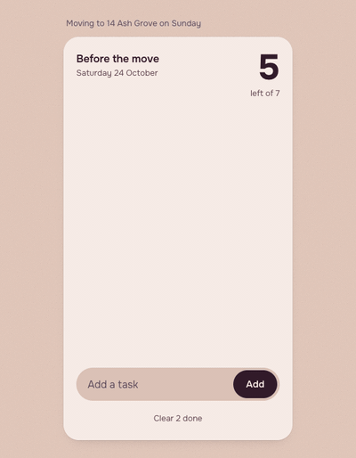

<p align="center">
  <picture>
    <source media="(prefers-color-scheme: dark)" srcset="media/banner-dark.png">
    
  </picture>
</p>

<p align="center">
  <a href="LICENSE"></a>
  <a href="https://skills.sh/hirowyh/settle"></a>
</p>

<p align="center"></p>
<p align="center"><sub>Made by settle from a single prompt, untouched.</sub></p>

settle is a skill for coding agents such as Claude Code. Describe a piece of interface the way you'd tell a friend, and your agent builds it with motion that settles like a real object, in a look picked fresh for each request.

```bash
npx skills@latest add hirowyh/settle
```

Run it in your project's folder, or add `-g` to use settle in every project. In Claude Code you can install it as a plugin instead:

```text
/plugin install settle --marketplace hirowyh/settle
```

To have it update itself, open `/plugin`, go to Marketplaces, pick settle and choose Enable auto-update. Then ask your agent for what you want, such as "make a switch that feels really nice to click". settle writes the piece in the project's own code and style, with no new packages. Anywhere else, you get one HTML file that opens in any browser.

## The same request, with and without settle

<table>
  <tr>
    <th width="50%">Without settle</th>
    <th width="50%">With settle</th>
  </tr>
  <tr>
    <td colspan="2" align="center"><sub>"i need a download button that shows the progress and then says it's done"</sub></td>
  </tr>
  <tr>
    <td align="center"></td>
    <td align="center"></td>
  </tr>
  <tr>
    <td colspan="2" align="center"><sub>"bar chart of how many tickets each person on my team closed this sprint, fancy enough for a presentation"</sub></td>
  </tr>
  <tr>
    <td align="center"></td>
    <td align="center"></td>
  </tr>
  <tr>
    <td colspan="2" align="center"><sub>"a todo list where i can tick things off and drag them to reorder"</sub></td>
  </tr>
  <tr>
    <td align="center"></td>
    <td align="center"></td>
  </tr>
</table>

## More to ask for

Loose requests work too: "10 second promo animation for my habit tracker app, to post on twitter" is enough. settle can also smooth out motion you already have, like FAQ answers that snap open and shut. If a look doesn't suit you, ask for another.

<details>
<summary>Requirements</summary>

<br>

settle runs small scripts on Node 22 or later to pick each look and to check each piece frame by frame, so a piece takes a few minutes. The frame check drives a Chromium-based browser in the background and finds it by itself; Windows already has one in Edge. If yours sits somewhere unusual, set the `CHROME` variable to its path. Without such a browser, settle still builds the piece and tells you the frames went unchecked. The pieces run in any modern browser, and settle tests them in Chromium and in Safari's WebKit. Exporting a demo as MP4 or GIF also needs ffmpeg.

settle is built and tested with Claude Code. The installer can add it to other agents that load skills.

</details>

<details>
<summary>Credits</summary>

<br>

settle writes every rule in its own words, and takes ideas and some values from these projects:

- [Emil Kowalski's skills](https://github.com/emilkowalski/skills)
- [taste-skill](https://github.com/Leonxlnx/taste-skill)
- [ui-ux-pro-max](https://github.com/nextlevelbuilder/ui-ux-pro-max-skill)
- [impeccable](https://github.com/pbakaus/impeccable)
- [Vercel's web interface guidelines](https://github.com/vercel-labs/web-interface-guidelines)
- [Anthropic's frontend-design skill](https://github.com/anthropics/skills/tree/main/skills/frontend-design)

Google Stitch's DESIGN.md format and Apple's iOS 27 and macOS 27 UI kits shaped its layouts, and it ships none of their assets. [`skills/settle/NOTICE.md`](skills/settle/NOTICE.md) says what came from each project and holds their licence texts.

</details>

## Questions

Ask in [Discussions](https://github.com/hirowyh/settle/discussions).

## License

[Apache 2.0](LICENSE)
